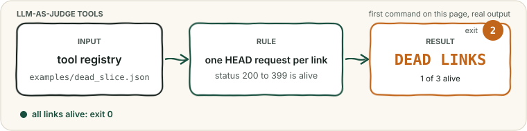

# judge-map

**Curated tool lists go stale: links die, and nobody notices until a reader hits a 404.**

[](https://github.com/homayoun-safarpour/judge-field-guide/actions/workflows/ci.yml)


LLM-as-judge tools: link-checked map of tools for language-model judges, with a checker that names dead links (exit 0 or 2).

judge-field-guide is a map of 20 open-source tools for language-model judges, kept as one JSON file with a tested link checker. We built it because the links in a curated list stop working over time, and a reader usually finds a dead link before the maintainer does. Given a registry file, the checker sends a HEAD request to each URL, follows redirects and counts a final status from 200 to 299 as alive, while a redirect it could not follow (a loop or a 304), an error status or no answer counts as dead. It prints each entry with its HTTP status and returns exit 0 when every link is alive or 2 when any is dead, so that CI names the dead entries.

```bash
git clone https://github.com/homayoun-safarpour/judge-field-guide
cd judge-field-guide && pip install -e .
python -m judgefieldguide.check_links --registry examples/dead_slice.json --stub-status examples/stub_dead.json
```

```text
name | status | ok
--- | --- | ---
alive-one | 200 | yes
dead-one | 404 | NO
timeout-one | None | NO

1/3 links alive.
Dead: dead-one, timeout-one
```

That command exits 2. `--stub-status` replaces the network with a fixed map of URL to status, and a URL missing from the map counts as no answer.



[How it works](#how-it-works) · [Results](#what-each-result-means) · [Limits](#limits) · [Interview pack](docs/INTERVIEW.md) · Part of [a small open stack for checking AI agents and their judges](https://homayoun-safarpour.github.io)

## What each result means

| Exit | Meaning |
|---|---|
| 0 | Every URL in the registry answered, after redirects, with a status from 200 to 299. |
| 2 | At least one URL answered with another status or did not answer. The report lists those entries after `Dead:`. |
| 1 | The registry or the `--stub-status` file could not be read, the stub file is not a JSON object, or the registry failed its schema check (an empty registry fails it too). The checker prints one line and checks nothing. |

An exit 0 shows that each URL answered on the day of the run. It does not show that the tool behind the link works, is maintained or is any good. Each exit has named tests: 0 (`test_evaluate_exit_code_zero_when_all_alive`), 2 (`test_evaluate_exit_code_two_when_any_dead`, `test_readme_stranger_stub_exits_2`) and 1 (`test_main_empty_registry_exits_1_with_one_line`, `test_main_non_object_entry_exits_1_with_one_line`, `test_main_stub_not_object_exits_1`). The limits of each claim are in [docs/RELIABILITY_CARD.md](docs/RELIABILITY_CARD.md).

## Use this when

| Situation | Use judge-field-guide? |
| --- | --- |
| You want a short list of tools for language-model judges, grouped by the job each tool does | Yes |
| You keep links in this registry format and want a check that names the dead ones with exit 0 or 2 | Yes |
| You want every judge tool there is, ranked by votes | No. Use a broader list such as [CSHaitao/Awesome-LLMs-as-Judges](https://github.com/CSHaitao/Awesome-LLMs-as-Judges), which is one of the entries |
| You want a judge or a judge metric itself | No. Use [judge-reliability-kit](https://github.com/homayoun-safarpour/judge-reliability-kit) or [judge-drift-sentinel](https://github.com/homayoun-safarpour/judge-drift-sentinel) |
| You need to know whether a linked tool works | No. The checker only tests that the URL answers |

Interview pack: [docs/INTERVIEW.md](docs/INTERVIEW.md).

## The problem

A list of links in a markdown file has no test, so it is correct only on the day it was written. When a repository is renamed or deleted, the list keeps pointing at it, and the first person to find out is a reader who clicks the link. Here every entry lives in a JSON registry with a schema, and a link check runs in CI, so a dead entry shows up as a failed check with its name.

## The map

The registry is [data/registry.json](data/registry.json). Each entry has a `name`, a `url`, a `category`, a `why` written for this registry, and a `last_verified` date.

| Code | Group | What the tools do | Entries |
| --- | --- | --- | --- |
| A | Meta-evaluate the judge | Kappa, bias correction, disagreement decomposition | 9 |
| B | Living and adversarial benchmarks | Test judges against harder, changing cases | 2 |
| C | Eval-driven systems and gates | Metrics that gate a deploy instead of only reporting a score | 5 |
| D | Open harness norms | Shared libraries and curated maps of judge tools | 4 |

## How it works

1. `judgefieldguide.registry` loads the registry and rejects an empty list, an entry that is not a JSON object, a missing field, a category outside A to D, a `last_verified` date not in `YYYY-MM-DD` form, a URL that does not start with `http://` or `https://`, and a repeated name or URL. Names are compared without case, and URLs without the case of the scheme and host or a trailing slash ([tests/test_registry.py](tests/test_registry.py), [tests/test_registry_fail_closed.py](tests/test_registry_fail_closed.py)).
2. `judgefieldguide.check_links` keeps the network call inside `fetch_status`, so the pass and fail logic is tested offline with a fake fetcher ([tests/test_check_links.py](tests/test_check_links.py), [tests/test_check_links_fail_closed.py](tests/test_check_links_fail_closed.py)). `--stub-status` does the same from the command line. A URL that gives no answer is tried once more, then shown as `timeout` or `unreachable`.
3. CI runs `ruff` and the tests on Python 3.10, 3.11 and 3.12. A separate `link-check` job runs the live check on every push and pull request and every Monday at 06:00 UTC. The check runs under `set -o pipefail`, so a dead link fails the job. On push and pull request runs that failure does not block the build. On the Monday run it fails the run, opens an issue labelled `link-rot` unless one is already open, and stamps nothing. When the Monday check is green, `stamp_verified` reads the check's JSON report, writes today's date into `last_verified` for each entry the report marks alive, and commits it. [tests/test_ci_workflow.py](tests/test_ci_workflow.py) reads the workflow and fails if the check is piped without pipefail.

```bash
pip install -e ".[dev]"
python -m pytest -q
python -m judgefieldguide.check_links
```

On 25 Nov 2026 the tests printed `54 passed in 0.52s`. On 20 Nov 2026 the live check, which needs network access, printed one row per entry, ended with `20/20 links alive.` and exited 0.

| Module | What it does |
|---|---|
| `judgefieldguide.registry` | Loads `data/registry.json` and checks its schema |
| `judgefieldguide.check_links` | Checks every URL, prints the report and returns exit 0 or 2 |
| `judgefieldguide.stamp_verified` | Writes a `last_verified` date into each entry that the link-check report (`--report`) marks alive; refuses a missing report or a date that is not a real `YYYY-MM-DD` |

## Limits

- It is not a complete index. It holds 20 entries chosen by one person, and the A to D groups are a judgement call.
- The check sends HEAD requests only. A server that refuses HEAD (for example with 405) counts as dead, even if the page opens in a browser.
- A dead link fails the `link-check` job but does not block a push or a pull request, because a third-party site can be down for a day. Only the Monday run is marked failed.
- `last_verified` is stamped only after a fully green Monday run, so in practice every entry carries the same date.
- The checker reports `timeout` and `unreachable` only after one retry with HEAD. It does not fall back to GET.
- The checker uses the Python standard library only and needs Python 3.10 or later.

## Related tools

- [judge-reliability-kit](https://github.com/homayoun-safarpour/judge-reliability-kit): why a judge panel disagrees (kappa).
- [judge-drift-sentinel](https://github.com/homayoun-safarpour/judge-drift-sentinel): tells judge drift from system drift.
- [trace-gate](https://github.com/homayoun-safarpour/trace-gate): a deploy gate on agent runs.

## Credit

This is an independently curated, re-verified registry, not a fork. The idea started
from reading `haizelabs/Awesome-LLM-Judges` (entry D1 in the registry, credited there), which
has no license and is a plain link list. Rather than fork unlicensed content, every entry here
was re-selected, re-described in original language, and wired to a real test. MIT-licensed,
fork freely.

## Contributing

See [CONTRIBUTING.md](CONTRIBUTING.md).

## Author

Homayoun Safarpour. [LinkedIn](https://www.linkedin.com/in/homayoun-safarpour/)

## License

MIT. See [`LICENSE`](LICENSE).
